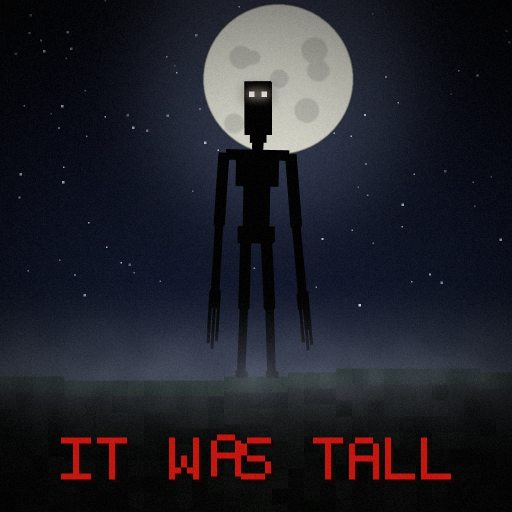

<!--
CurseForge project page text.
Summary:
A Fabric horror mod featuring a tall creature that watches players, chases them, digs through underground tunnels, and triggers individual atmospheric scares.

Suggested categories: Mobs, Adventure and RPG
-->

# It Was Tall

**It Was Tall** is a horror mod for **Minecraft 1.21.1 using Fabric**. It adds a tall creature that appears at a distance, watches players, and can begin chasing them when approached or watched for too long.

## The creature

- Appears at a distance at night and watches the player.
- Can start chasing when a player approaches it or watches it for too long.
- Can stop pursuing when the player reaches a sheltered area, then sink into the ground.
- Has animations for standing, walking, chasing, sinking, digging, knocking and attacking.
- Can change its target when another player approaches or attacks it.

## Underground events

After players spend time underground, the mod can trigger mine events:

- The creature can appear in nearby stone and dig towards the player with an iron pickaxe.
- Cracking block effects and digging sounds indicate its approach.
- Torches can go out, starting with torches farther from the player.
- The creature can appear behind the player with breathing sounds.
- It cannot dig through obsidian or bedrock.
- Digging respects the `mobGriefing` gamerule.

## Sounds and screen effects

- Includes 82 custom sound files used for screams, growls, sniffing, whispers, breathing, footsteps, ambience, digging and other events.
- Random small scares can play, such as branches cracking, stones falling, window knocks, creaking doors, footsteps and whispers.
- Ambient sounds vary depending on whether the player is underground, outside at night, inside a base at night or in daytime.
- A heartbeat can be heard when the creature is nearby.
- Red on-screen messages can appear with flickering and glitch effects.
- Jumpscares can display a brief image and play a loud sound.

## Multiplayer

- The mod supports multiplayer when installed on the server and on every client.
- Each player has separate haunting events, timers, sounds, messages and jumpscares.
- Personal scare sounds and screen effects are sent only to the affected player.
- Other players can see the creature in the world.
- The server limits the number of active creatures. The default limit is 3.

## Commands

The following commands require operator permissions and can also be used from the server console.

| Command | Description |
|---|---|
| `/itwastall spawn [distance] [player]` | Spawns the creature in front of a player. |
| `/itwastall haunt [players]` | Triggers a natural-style appearance in the distance. |
| `/itwastall jumpscare [players]` | Triggers a jumpscare. |
| `/itwastall scare [players]` | Plays a small scare sound. |
| `/itwastall message [players] [text]` | Displays a red on-screen message. |
| `/itwastall mine dig\|sounds\|torches\|peek [player]` | Triggers a selected underground event. |
| `/itwastall status` | Shows the number of active creatures. |

Example: `/itwastall message Steve it sees you.`

## Configuration

The main configuration file is `config/itwastall.json`. It includes options for:

- Jumpscare images and duration.
- Natural appearances, their intervals and night-only behavior.
- The maximum number of active creatures.
- Underground events and digging behavior.
- Scare sounds and their intervals.
- Ambient sounds.
- On-screen scare messages and custom message text.

The first-join warning screen also lets each player enable or disable scare effects.

## Requirements

- Minecraft **1.21.1**
- Fabric Loader **0.20.1** or newer
- Fabric API
- GeckoLib for Fabric **4.9.3** or newer

For multiplayer, install the mod on the server and on every client.

## Content warning

This mod contains jumpscares, brief flashing images, sudden loud sounds and horror effects. Players who do not want these effects can disable scares in the warning screen. The jumpscare image can also be disabled in the configuration.

---

Source code: https://github.com/vcbgf5/it-was-tall
