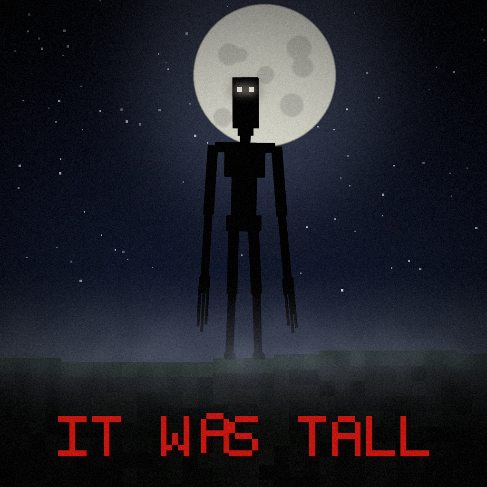

<p align="center"></p>

# It Was Tall

Horror mod do Minecrafta (**Fabric 1.21.1**). Coś wysokiego cię obserwuje. Nie pozwól, żeby poszło za tobą do domu.

## Co już jest
- **Postać „To” (It)**: model GeckoLib, ~3,5 bloku wysokości, twarz ze zdjęcia, świecąca w nocy, 7 animacji
  (stoi i patrzy, chód, pościg, zapada się, kopie, puka w szybę, atak).
- **Główna scena**: stoi i się patrzy → podchodzisz (lub długo się gapisz i idziesz do niego) → **goni cię** →
  wbiegasz do bazy (dach + ściany) → **zapada się pod ziemię** → **jumpscare na 0,1 s**.
- **Kopalnia** (po ~60 s pod ziemią, losowo, z cooldownem):
  - **kopie się do ciebie**: pojawia się w skale do 30 bloków nad tobą i przekopuje się żelaznym kilofem
    (tunel 1×4, widać pękanie bloków; obsydianu i bedrocka nie ruszy), potem goni.
    Jeśli w pościgu nie może przejść niskim tunelem, znowu zaczyna kopać.
  - **dźwięki kopania** zbliżające się z góry,
  - **gasną pochodnie** za twoimi plecami, od najdalszej do najbliższej,
  - **stoi za tobą**: odwrócisz się = jumpscare.
- **Własne straszne dźwięki** (82 pliki w 40 zdarzeniach, generowane proceduralnie): krzyki z łamiącym się głosem,
  warczenie, węszenie, bicie serca, szepty i oddech za plecami, drony, buczenie, wiatr, skrzypienie, kapanie, łańcuchy,
  osypujące się kamienie, odwrócony głos, pukanie w szybę, kilof, jumpscare + piszczenie w uszach.
- **Małe straszaki co 20–60 s**: trzask gałązki, spadający kamyk, stuk w szybę, skrzypnięcie drzwi, kulejące kroki
  za plecami, szept „run…” przy uchu, chichot, zgrzyt metalu, pozytywka… (zależnie od miejsca, słyszysz tylko ty).
- **Napis na ekranie „don't hide. just run.”**: czerwony, migoczący, z glitchami. Pojawia się po tym, jak schowasz się
  w bazie (po jumpscarze), gdy długo siedzisz w bazie w nocy i czasem losowo w nocy / w kopalni.
- **Ambient zależny od miejsca**: kopalnia / noc na zewnątrz / noc w bazie / dzień (rzadko). Gdy „To” jest blisko,
  słychać bicie serca. Dźwięki słyszy tylko ten gracz, którego dotyczą.
- Config: `config/itwastall.json` (jumpscare, czas jumpscare'a, odległości, kopanie, częstotliwość zdarzeń w kopalni…).

## Multiplayer
- Mod musi być **na serwerze i u każdego gracza** (Fabric + Fabric API + GeckoLib).
- Każdy gracz ma **własne** nawiedzenie: osobne timery pojawiania się, straszaków, napisów i zdarzeń w kopalni.
- Dźwięki-straszaki, ambient, napisy i jumpscare dostaje **tylko ten gracz**, którego dotyczą. Inni mogą zobaczyć
  samą postać (to normalny mob), ale nie słyszą jego szeptów.
- „To” patrzy na jednego gracza, ale jeśli **ktoś inny podejdzie za blisko**, rzuca się na niego. Kto go uderzy,
  ten staje się celem.
- Samo z siebie pojawia się w nocy co 8–16 min na gracza (pierwszy raz po ~3 min); nigdy dwa przy jednym graczu;
  limit na serwer: `maxActiveIts` (domyślnie 1).

## Komendy (OP, działają też z konsoli serwera)
| Komenda | Co robi |
|---|---|
| `/itwastall spawn [odległość] [gracz]` | stawia go przed graczem (domyślnie 30 bloków), patrzy na niego |
| `/itwastall haunt [gracze]` | pojawia się „naturalnie”: w oddali, przed graczem |
| `/itwastall jumpscare [gracze]` | jumpscare 0,1 s |
| `/itwastall scare [gracze]` | mały straszak od razu |
| `/itwastall message [gracze] [tekst]` | napis na ekranie (domyślnie „don't hide. just run.”) |
| `/itwastall mine dig\|sounds\|torches\|peek [gracz]` | wymusza zdarzenie z kopalni |
| `/itwastall status` | ile postaci jest teraz na serwerze |

Np. `/itwastall message Kolega it sees you.` albo z konsoli: `itwastall jumpscare @a`.

## Budowanie
Wymaga Javy 21.
```bash
./gradlew build        # jar w build/libs/
./gradlew runClient    # odpala grę z modem
```
Zależności w grze: Fabric Loader, Fabric API, GeckoLib (Fabric 1.21.1).

## Narzędzia (tools/)
- `gen_model.py` – generuje model (`geo/entity/tall_one.geo.json`) i tekstury z `tools/source/face_photo.png`.
- `gen_animations.py` – generuje animacje.
- `build_icon.py` – ikona moda: render sylwetki z prawdziwego modelu + noc, księżyc, mgła, napis (Pillow + three.js).
- `gen_sounds.py` – syntezuje wszystkie dźwięki (numpy + ffmpeg).
- `build_sound_preview.py` + `preview/it_was_tall_sounds.html` – strona do odsłuchu dźwięków.
- `build_preview.py` + `preview/it_was_tall_preview.html` – podgląd 3D w przeglądarce (z animacjami i sceną).
  Do przebudowania podglądu potrzebny jest `tools/preview/three.min.js` (three.js r128).

> Uwaga: `tools/source/face_photo.png` (twarz i jumpscare) wygląda na zdjęcie stockowe. Przed publicznym wydaniem
> moda podmień je na obraz, do którego masz prawa, i uruchom `python3 tools/gen_model.py`.

## Plan
6 etapów strachu, wykrywanie i mapowanie bazy z podglądem 3D, pukanie w szyby, zadania („Nie wychodź na zewnątrz”,
„Chowany”), struktury, własne GUI.
